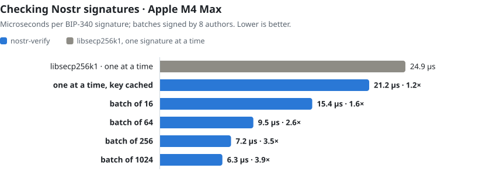
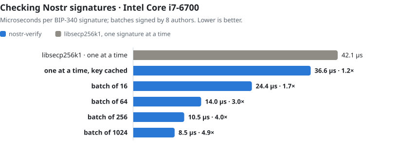

<h1 align="center">nostr-verify</h1>

<p align="center">
  <b>Nostr signatures, checked in batches.</b><br>
  BIP-340 Schnorr batch verification in Rust, with a cache of parsed keys. Every verdict is libsecp256k1's.
</p>

<p align="center">
  <a href="LICENSE"></a>
  
  
</p>

<picture>
  <source media="(prefers-color-scheme: dark)" srcset="bench/macos-dark.svg">
  
</picture>

- **2.6–3.0× faster at 64 signatures, 3.9–5.0× at 1024**, when a batch's events come from a
  handful of authors (as on a relay, in a sync, or in a page of history), on an Apple M4 Max and
  an Intel Core i7-6700.
- **Faster even when every signature has its own key**: 1.4–1.6× at 64, 1.8–2.2× at 1024. A
  signature checked alone gains about 1.15× from the key cache.
- **The same verdicts as libsecp256k1.** A batch that fails is narrowed down and its signatures
  are checked one at a time by libsecp256k1, so every `false` is the reference verifier's.

Written for [Magnitude Relay](https://github.com/VectorPrivacy/magnitude-relay), where it made
bulk ingest 3.6× faster per core. Being adopted by [Vector](https://github.com/VectorPrivacy/Vector)
for gift-wrapped DMs, where it takes 18–27% off the time to open each message when senders
repeat.

## Install

```toml
[dependencies]
nostr-verify = "0.1"
```

For `wasm32-unknown-unknown` in a browser, turn on `js` so the batch weights' randomness comes
from the Web Crypto API:

```toml
nostr-verify = { version = "0.1", features = ["js"] }
```

## Use

A signature is three byte arrays: the author's x-only public key, the event id (the signed
message) and the 64-byte signature.

```rust
use nostr_verify::{SigRef, Verifier};

let mut verifier = Verifier::new();
let sigs: Vec<SigRef> = events
    .iter()
    .map(|(pubkey, id, sig)| SigRef { pubkey, msg: id, sig })
    .collect();
let mut ok = Vec::new();
verifier.verify_batch(&sigs, &mut ok);
// ok[i] is whether sigs[i] is valid
```

Keep one `Verifier` per thread and reuse it: it holds the key cache and the buffers a batch
needs. Making one reads 32 bytes from the operating system's random source.

**Check event ids first.** Only signatures are checked here. Hash each event's NIP-01
serialization and compare it with its id before handing the id over as the signed message, as
`Event::verify` does in that order.

### With rust-nostr

```rust
use nostr::Event;
use nostr_verify::{SigRef, Verifier};
use std::cell::RefCell;

thread_local! {
    static VERIFIER: RefCell<Verifier> = RefCell::new(Verifier::new());
}

/// Whether each event's signature is valid, in order. Check `event.verify_id()` first.
fn signatures(events: &[&Event]) -> Vec<bool> {
    let sigs: Vec<SigRef> = events
        .iter()
        .map(|e| SigRef { pubkey: e.pubkey.as_bytes(), msg: e.id.as_bytes(), sig: e.sig.as_bytes() })
        .collect();
    let mut ok = Vec::new();
    VERIFIER.with_borrow_mut(|v| v.verify_batch(&sigs, &mut ok));
    ok
}
```

nostr-verify links the same `secp256k1` 0.30 as rust-nostr 0.45, so an app with both carries
one libsecp256k1.

### The calls

| | |
|---|---|
| `Verifier::verify_batch(&sigs, &mut ok)` | One verdict per signature. Returns whether the whole batch passed at once. Fewer than `MIN_BATCH` (3) signatures are checked one at a time. |
| `Verifier::verify_all(&sigs)` | The batch equation alone: `true` when every signature is valid, `false` when at least one is not (not which). |
| `Verifier::verify_one(&sig)` | libsecp256k1, with the key from the cache. |
| `nostr_verify::verify_one(&sig)` | libsecp256k1, no cache: the reference the tests compare against. |
| `Verifier::stats()` | Counters: batches and how many held, signatures accepted by a batch, signatures checked one at a time, key-cache hits and misses. |

Batching pays when signatures arrive together: relay ingest, a sync, a history backfill, a page
of events. An event checked on its own still gains the key cache.

## Benchmarks

`cargo run --release --example batch` signs its own events and reports microseconds per
signature, median of 21 rounds. Batches get new keys every round, so only repeats inside a
batch help; on real traffic, authors seen in earlier batches also hit the key cache.

### macOS · Apple M4 Max

| µs per signature | n keys | 8 keys | 1 key |
|---|---:|---:|---:|
| libsecp256k1, one at a time | 24.88 | | |
| with the key cache | | 21.21 (1.17×) | |
| batch of 16 | 21.80 (1.14×) | 15.43 (1.61×) | 10.19 (2.44×) |
| batch of 64 | 17.64 (1.41×) | 9.46 (2.63×) | 8.39 (2.97×) |
| batch of 256 | 15.32 (1.62×) | 7.20 (3.46×) | 7.05 (3.53×) |
| batch of 1024 | 13.84 (1.80×) | 6.32 (3.94×) | 6.18 (4.03×) |

### Linux x86-64 · Intel Core i7-6700

<picture>
  <source media="(prefers-color-scheme: dark)" srcset="bench/x86-dark.svg">
  
</picture>

| µs per signature | n keys | 8 keys | 1 key |
|---|---:|---:|---:|
| libsecp256k1, one at a time | 42.13 | | |
| with the key cache | | 36.56 (1.15×) | |
| batch of 16 | 34.61 (1.22×) | 24.44 (1.72×) | 15.09 (2.79×) |
| batch of 64 | 26.32 (1.60×) | 13.98 (3.01×) | 12.36 (3.41×) |
| batch of 256 | 21.72 (1.94×) | 10.49 (4.02×) | 9.84 (4.28×) |
| batch of 1024 | 19.04 (2.21×) | 8.52 (4.95×) | 8.43 (5.00×) |

Measured on one core of a production server (pinned, never idle), so absolute numbers drift by
a few percent; the ratios hold. `python3 bench/chart.py` draws the charts from
`bench/results.json`.

## How it works

One Schnorr verification is a double-scalar multiplication, most of it a chain of 128 point
doublings that every signature pays for again. A batch of u signatures is one equation instead:

```text
(Σ aᵢsᵢ)·G  −  Σ aᵢ·Rᵢ  −  Σ (aᵢeᵢ)·Pᵢ  ==  infinity
```

with Rᵢ and Pᵢ the points of each signature's r and its author's key, eᵢ the BIP-340 challenge,
a₁ = 1 and every other aᵢ a fresh 128-bit weight nobody outside the process can predict. If
every signature is valid the equation holds. If one is not, it holds only when the weights
happen to cancel the error, with probability at most 2⁻¹²⁸, the work of breaking a secp256k1
key by brute force.

- **One multi-scalar multiplication** for the whole sum: Strauss with interleaved wNAF tables
  for small batches, Pippenger's bucket method for large ones, the switch point and window
  widths tuned by sweep. Every 256-bit scalar is split into two 128-bit halves with the GLV
  endomorphism, halving the doubling chain.
- **Authors merged**: signatures by the same key add their scalars into one term, so a batch
  from 8 authors carries 8 key terms, not one per signature.
- **Keys cached**: turning a 32-byte key into a point costs a field square root (about 4 µs).
  Each `Verifier` keeps 2,048 parsed keys, two-way set associative under a per-instance salt.
- **Challenges hashed together**: BIP-340's tagged hashes share a 64-byte prefix, so each
  challenge starts from a precomputed SHA-256 midstate. ARM and SHA-NI CPUs hash with their
  SHA instructions; x86 CPUs without them hash eight challenges at once in AVX2 lanes.
- **Weights** come from SHA-256 of a per-verifier key and a counter, the key from the
  operating system's CSPRNG. Without randomness the weights could be predicted, so the
  verifier panics rather than fall back.

Verification handles only public data (keys, messages, signatures), so none of this needs to
be constant-time.

## Tested

- The field, scalar and group arithmetic against big-integer reference arithmetic and against
  libsecp256k1: square roots, point additions and doublings, multi-scalar sums.
- BIP-340's test vectors, and random batches of valid and corrupted signatures (flipped bits
  in the signature, message or key, a random key or r, r not below p, s not below n, s + n,
  the negated nonce point), every verdict compared with libsecp256k1's own verifier.
- `SECP_DIFF_SCALE=<k> cargo test --release -- --include-ignored` multiplies every count. The
  suite has run by the million on the x86 production server, and at ten times its default on
  an Apple M4 Max.

## Minimum Rust

1.85. `sha2` 0.11.1 needs 1.88; Cargo's MSRV-aware resolver picks 0.11.0 on older toolchains.

## License

MIT
